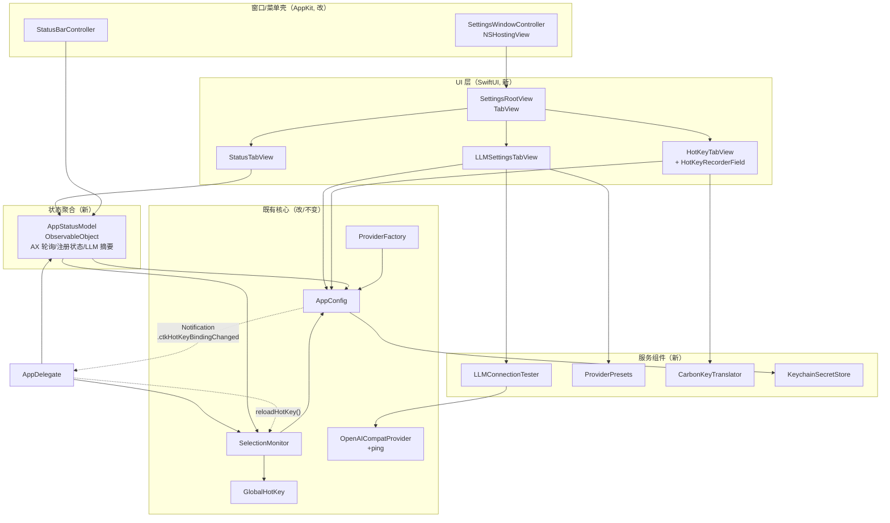
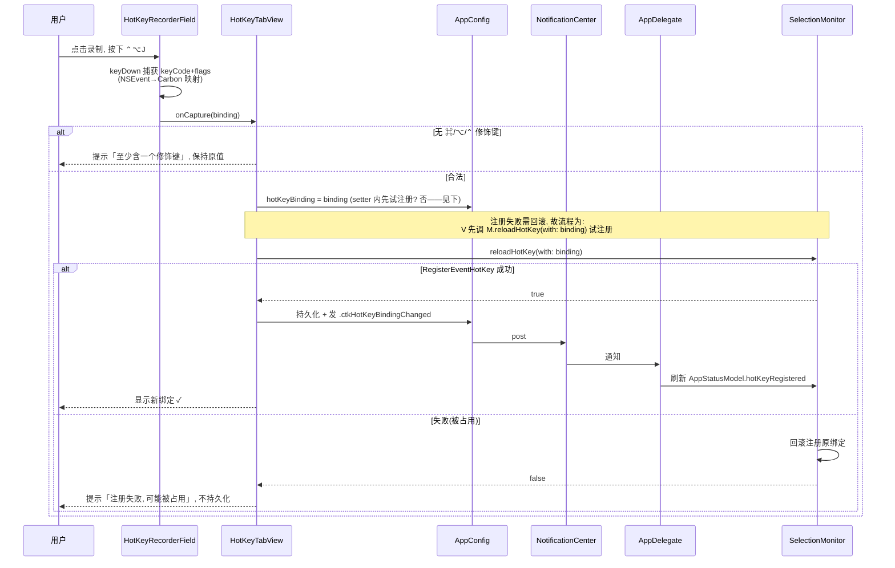
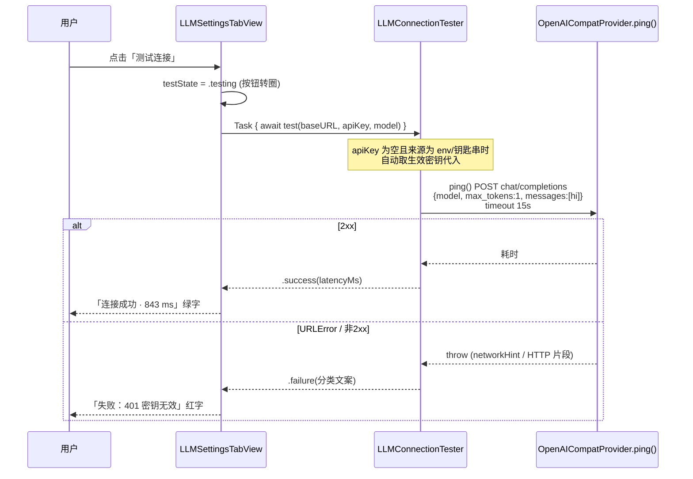

# Design Document

## Overview

在现有纯 AppKit 菜单栏应用的基础上，引入 SwiftUI（经 `NSHostingView` 混合）重构设置窗口为三 Tab 的「设置与状态中心」，并向下沉淀四个支撑组件：

1. **配置层扩展**：`AppConfig` 新增快捷键绑定持久化、密钥来源解析、掩码 API 与变更通知。
2. **密钥安全层**：新增 `KeychainSecretStore`，密钥写入迁移到钥匙串，带 UserDefaults 回退与一次性迁移。
3. **运行时状态聚合**：新增 `AppStatusModel`（ObservableObject），聚合辅助功能权限（`AXIsProcessTrusted` 轮询）、热键注册状态、LLM 就绪状态、版本/路径信息，供 SwiftUI 与菜单栏菜单消费。
4. **服务组件**：`CarbonKeyTranslator`（keyCode/修饰键 → `⌥⌘K` 可读串及反向映射）、`ProviderPresets`（供应商预设数据）、`LLMConnectionTester` + `OpenAICompatProvider.ping()`（连通测试）。

划词主流程（快捷键 → 模拟 ⌘C → Provider 释义 → NSPanel 展示）**不改行为**，仅把热键来源从硬编码改为读配置、支持热重注册。

## Steering Document Alignment

### Technical Standards (tech.md)
仓库暂无 steering 文档，以现有代码库事实约定为准，本设计全部遵循：
- Swift 5.9 / macOS 13+，纯 SPM 可执行 target，零第三方依赖（新增仅系统框架 SwiftUI、Security）。
- UI 线程隔离统一 `@MainActor`；耗时操作 `async/await` 或 `Task.detached`。
- 配置持久化统一走 `AppConfig`（suite `ClickToKnow` 的 UserDefaults），不直接散用 `UserDefaults.standard`。
- 日志用 `NSLog("[ClickToKnow] ...")` 前缀；错误面向用户的文案集中在 `InterpretationError.userMessage` 风格。
- 注释解释「为什么」而非「做什么」（如 `⌥⌘D 与系统冲突` 一类决策注释）。

### Project Structure (structure.md)
沿用现有目录职责，新增文件归位如下：

```
Sources/ClickToKnow/
├── App/
│   ├── AppDelegate.swift              [改] 装配 AppStatusModel、订阅热键变更通知
│   ├── StatusBarController.swift      [改] 菜单条目动态化（绑定串、权限状态）
│   └── SettingsWindowController.swift [重写] NSWindow 壳 + NSHostingView
├── Config/
│   ├── AppConfig.swift                [改] 快捷键/密钥来源/掩码/通知
│   ├── EnvLoader.swift                [不变]
│   ├── KeychainSecretStore.swift      [新] 钥匙串读写删 + 可用性探测
│   └── ProviderPresets.swift          [新] 供应商预设静态数据
├── Selection/
│   ├── GlobalHotKey.swift             [不变]
│   ├── SelectionMonitor.swift         [改] 读配置注册 + reloadHotKey()
│   ├── ClipboardManager.swift         [不变]
│   └── CarbonKeyTranslator.swift      [新] keyCode/修饰键 ↔ 可读串、NSEvent→Carbon 映射
├── Interpretation/
│   ├── OpenAICompatProvider.swift     [改] 新增 ping() 最小连通请求
│   ├── LLMConnectionTester.swift      [新] 表单值 → 测试结果（含分类与耗时）
│   └── 其余                            [不变]
├── Status/
│   └── AppStatusModel.swift           [新] 运行时状态聚合（ObservableObject）
└── UI/
    ├── MarkdownRenderer.swift         [不变]
    ├── ResultPopover.swift            [不变]
    └── Settings/
        ├── SettingsRootView.swift     [新] TabView 根视图
        ├── StatusTabView.swift        [新] 状态总览
        ├── LLMSettingsTabView.swift   [新] 大模型配置
        ├── HotKeyTabView.swift        [新] 快捷键设置
        ├── HotKeyRecorderField.swift  [新] NSViewRepresentable 按键录制控件
        └── StatusBadge.swift          [新] 绿/红圆点 + 文案的复用状态徽标
```

## Code Reuse Analysis

### Existing Components to Leverage
- **`AppConfig`**：扩展而非替换——保留 `apiKey/baseURL/model/hasLLMConfig/apiKeyFromEnvironment` 语义，新增快捷键与密钥来源 API；`ProviderFactory` 每次请求读最新配置的「立即生效」机制原样保留，LLM 表单保存后无需任何通知即可生效。
- **`GlobalHotKey`**：接口不动（`register/unregister/isRegistered`），`reloadHotKey` 即 `register` 的再次调用（内部已先 `unregister`）。
- **`OpenAICompatProvider`**：`interpret` 不动；新增 `ping()` 复用同一 ephemeral session、URL 拼装（`chatCompletionsURL`）与错误翻译（`networkHint`），避免第二套 HTTP 代码。
- **`InterpretationError.userMessage`**：连接测试失败文案直接复用其翻译结果。
- **`StatusBarController.openAccessibilitySettings`**：状态页「打开系统设置」按钮复用同一 URL scheme 逻辑（提取为共享函数 `SystemSettingsOpener.openAccessibility()`）。
- **`SettingsWindowController` 的窗口复用模式**：保留「懒创建 + showWindow 刷新」骨架，仅替换 contentViewController 为 NSHostingController。

### Integration Points
- **NotificationCenter**：新增 `.ctkHotKeyBindingChanged`（AppDelegate 订阅 → `SelectionMonitor.reloadHotKey()`）。LLM 配置变更**不发通知**（工厂按次读取，天然生效），仅钥匙串迁移完成时刷新 `AppStatusModel`。
- **UserDefaults suite `ClickToKnow`**：新增键 `hotKeyKeyCode`、`hotKeyModifiers`、`keychainMigrationDone`；删除遗留键 `apiKey`（迁移后）。
- **Keychain**：`kSecClassGenericPassword`，service=`ClickToKnow`，account=`apiKey`。裸可执行文件（ad-hoc 签名、每次重编译签名变化）可能触发系统询问或拒绝，故所有读写包 try 并回退。
- **Carbon HIToolbox**：`CarbonKeyTranslator` 使用 `kVK_ANSI_*` 常量表；修饰键常量 `cmdKey=256 / shiftKey=512 / optionKey=2048 / controlKey=4096`。

## Architecture



### Modular Design Principles
- **Single File Responsibility**：翻译（CarbonKeyTranslator）、存储（KeychainSecretStore）、测试（LLMConnectionTester）、聚合（AppStatusModel）各自独立文件；SwiftUI 每个 Tab 一个文件。
- **Component Isolation**：SwiftUI 视图不直接 touch `SelectionMonitor`/`GlobalHotKey`，一律经 `AppStatusModel` 或 NotificationCenter；`AppStatusModel` 不 import SwiftUI 之外的 UI 类型（仅 Observation/Foundation/AppKit 权限 API）。
- **Service Layer Separation**：视图（展示）→ AppStatusModel（状态聚合）→ AppConfig/服务组件（数据与业务）→ Carbon/Security/URLSession（系统）。
- **Utility Modularity**：掩码、修饰键映射、URL 校验均为纯函数，可单测。

### 关键时序 1：快捷键自定义（R3）



> 决策：**试注册先行、成功后才持久化**。`SelectionMonitor.reloadHotKey(with:) -> Bool` 是唯一入口，内部失败自动恢复旧热键，保证任何时刻都有可用绑定（除非旧键也失效，此时状态页显示「注册失败」红点）。

### 关键时序 2：连接测试（R2.3）



## Components and Interfaces

### AppConfig（扩展）
- **Purpose:** 全部用户配置的唯一读写口 + 变更广播。
- **Interfaces（新增部分）:**
  ```swift
  // 快捷键（默认 kVK_ANSI_K + cmdKey|optionKey）
  var hotKeyBinding: HotKeyBinding { get set }   // set 仅持久化+发通知，不做注册
  // 密钥解析链与展示
  enum APIKeySource: String { case environment, keychain, legacyUserDefaults, none }
  var apiKeySource: APIKeySource { get }
  var maskedAPIKey: String? { get }              // nil = 无密钥
  func setAPIKey(_ value: String) throws         // 空串=清除；优先钥匙串，失败回退 UserDefaults
  func migrateLegacyKeyIfNeeded()                // 启动时调用一次，幂等
  // 通知名
  static let hotKeyBindingChangedNotification: Notification.Name  // "ctkHotKeyBindingChanged"
  ```
  `apiKey` getter 优先级改为：**环境变量 → 钥匙串 → UserDefaults（遗留）**；原 setter 保留但内部转发 `setAPIKey`。
- **Dependencies:** `KeychainSecretStore`、`CarbonKeyTranslator`（displayString 计算）。
- **Reuses:** 现有 suite UserDefaults、`apiKeyFromEnvironment` 逻辑。

### KeychainSecretStore（新）
- **Purpose:** 密钥的钥匙串存取，隔离 Security 框架细节，可整体回退。
- **Interfaces:**
  ```swift
  enum KeychainSecretStore {
      static var isAvailable: Bool { get }              // 一次探测（读空 account）缓存结果
      static func save(_ value: String, account: String = "apiKey") -> Bool  // false=失败(调用方回退)
      static func load(account: String = "apiKey") -> String?
      static func delete(account: String = "apiKey")
  }
  ```
  实现要点：`kSecClassGenericPassword` + `kSecAttrService="ClickToKnow"`；save 先 `SecItemCopyMatching` 判断存在→`SecItemUpdate`（避免 `errSecDuplicateItem`）；所有 OSStatus 非 `errSecSuccess/errSecItemNotFound` 记 NSLog（不含密钥值）。
- **Dependencies:** Security.framework。

### CarbonKeyTranslator（新）
- **Purpose:** keyCode/Carbon 修饰键 ↔ 人类可读串；NSEvent 修饰键 → Carbon 掩码。
- **Interfaces:**
  ```swift
  struct HotKeyBinding: Codable, Equatable {
      var keyCode: UInt32
      var carbonModifiers: UInt32          // cmdKey|optionKey 等位掩码
      var displayString: String { get }    // "⌥⌘K"，未知键回退 "KeyCode(40)"
  }
  enum CarbonKeyTranslator {
      static func displayString(keyCode: UInt32, modifiers: UInt32) -> String
      static func carbonModifiers(from flags: NSEvent.ModifierFlags) -> UInt32
      static func hasRequiredModifier(_ carbonModifiers: UInt32) -> Bool  // 含 ⌘/⌥/⌃ 之一
      static let defaultBinding: HotKeyBinding   // ⌥⌘K
  }
  ```
  键名表：内置 `kVK_ANSI_*` 常用映射（A–Z、0–9、F1–F20、空格/回车/Tab/退格/方向键/常用标点，约 80 项）；修饰键顺序固定 `⌃⌥⇧⌘`。
- **Dependencies:** Carbon.HIToolbox 常量、AppKit（NSEvent）。

### ProviderPresets（新）
- **Purpose:** 预设供应商静态数据。
- **Interfaces:**
  ```swift
  struct ProviderPreset: Identifiable, Equatable {
      let id: String; let name: String
      let baseURL: String
      let suggestedModels: [String]
      let apiKeyOptional: Bool             // Ollama=true
  }
  enum ProviderPresets {
      static let all: [ProviderPreset]     // 见「数据模型」节的预设表
      static func matching(baseURL: String) -> ProviderPreset?  // 反查已存配置属于哪个预设, 否则 .custom
  }
  ```

### OpenAICompatProvider.ping()（扩展）
- **Purpose:** 最小代价验证 baseURL/密钥/模型三者组合可用。
- **Interfaces:**
  ```swift
  /// 发送 {model, max_tokens:1, messages:[{user:"hi"}]}，成功返回耗时；失败抛 InterpretationError
  func ping() async throws -> TimeInterval
  ```
  复用 `chatCompletionsURL`、session（超时收敛为 `min(15, 现有20)`——直接沿用 20s session，测试侧另行计时并在文案标注 15s 预期）、`networkHint`、HTTP 片段截取。选择 chat/completions 而非 `GET /models` 的原因：**能同时验证模型名可访问**（最常见错误是模型名拼错/无权限，`/models` 验证不到）。
- **Dependencies:** 无新增。

### LLMConnectionTester（新）
- **Purpose:** 面向 UI 的测试门面：输入表单值，输出可展示结果。
- **Interfaces:**
  ```swift
  struct LLMConnectionTester {
      enum Result: Equatable {
          case success(latencyMs: Int)
          case failure(reason: String)     // 已分类的中文文案
      }
      /// apiKey 传空时自动代入 AppConfig 当前生效密钥（env/钥匙串）
      func test(baseURL: String, apiKey: String, model: String) async -> Result
  }
  ```
- **Reuses:** `OpenAICompatProvider.ping()`、`InterpretationError.userMessage`。

### AppStatusModel（新）
- **Purpose:** 运行时状态单一聚合点，SwiftUI 与菜单栏共同消费；托管 AX 轮询生命周期。
- **Interfaces:**
  ```swift
  @MainActor
  final class AppStatusModel: ObservableObject {
      @Published private(set) var accessibilityGranted: Bool
      @Published private(set) var hotKeyBinding: HotKeyBinding
      @Published private(set) var hotKeyRegistered: Bool
      @Published private(set) var llmReady: Bool
      @Published private(set) var activeModel: String        // "" = 系统词典
      @Published private(set) var keySource: AppConfig.APIKeySource
      @Published private(set) var maskedKey: String?
      let appVersion: String                                  // 常量, 如 "0.2.0"
      var executablePath: String { get }                      // Bundle.main / _CommandLine argv0  realpath
      weak var selectionMonitor: SelectionMonitor?            // 读热键注册状态, 由 AppDelegate 注入

      func startMonitoring()   // 1s Timer 拉 AXIsProcessTrusted() + refresh()
      func stopMonitoring()
      func refresh()           // 立即全量拉取一次（菜单打开/Tab 切入/保存后调用）
  }
  ```
  轮询实现：`Timer.scheduledTimer` 持弱引用 self，`stopMonitoring` invalidate；`refresh()` 幂等可高频调用。
- **Dependencies:** ApplicationServices（AX）、AppConfig、SelectionMonitor（只读）。

### SelectionMonitor（扩展）
- **Purpose:** 热键注册来源改为配置，并支持热重注册。
- **Interfaces（新增部分）:**
  ```swift
  var isHotKeyRegistered: Bool { get }                 // 透传 GlobalHotKey.isRegistered
  /// 试注册新绑定；失败自动恢复原绑定并返回 false；成功更新 currentBinding
  @discardableResult func reloadHotKey(with binding: HotKeyBinding) -> Bool
  ```
  `start()` 改为 `reloadHotKey(with: AppConfig.shared.hotKeyBinding)`；内部持 `currentBinding` 供回滚。
- **Reuses:** `GlobalHotKey`（register 已含 unregister，天然幂等）。

### SettingsWindowController（重写壳）
- **Purpose:** NSWindow 壳 + NSHostingView 承载 SwiftUI；保留懒创建复用。
- **Interfaces:** `init(statusModel: AppStatusModel)`；`showWindow` 时 `statusModel.refresh()`；窗口 `delegate` 在 `windowDidBecomeKey` 启动监控、`windowWillClose` 停止（Tab 级停启由 StatusTabView onAppear/onDisappear 再控一层，双保险）。窗口 560×520、`[.titled, .closable]`、`isReleasedWhenClosed=false`、center。
- **Dependencies:** SwiftUI、AppStatusModel。

### SwiftUI 视图（新，UI/Settings/）
- **SettingsRootView**：`TabView` 三页 + `.environmentObject(statusModel)`；顶部无工具栏（窗口 titled 即可）。
- **StatusTabView**：`Form { Section }` 行布局，每行 = 标题 + `StatusBadge`/文本 + 尾部按钮；`.onAppear { startMonitoring }`、`.onDisappear { stopMonitoring }`；「打开系统设置」按钮复用 `SystemSettingsOpener`。
- **LLMSettingsTabView**：本地 `@State` 表单（preset 选择、baseURL、apiKey SecureField、model 可编辑 Picker `NSComboBox` 风格——用 `Picker` + 「自定义…」项或 menu+TextField 组合，实现取简：`TextField` + 下方推荐模型 chips）；「测试连接」按钮绑定 `.task` 与 `testState`；「保存」「清除已存密钥」；密钥来源提示行（env 提供时输入框禁用并显示掩码）。
- **HotKeyTabView**：当前绑定展示 + `HotKeyRecorderField` + 「恢复默认」。
- **HotKeyRecorderField**：`NSViewRepresentable` 包装一个自定义 `NSView`（`acceptsFirstResponder=true`，`keyDown` 捕获 `keyCode + modifierFlags`，`Esc` 取消，`becomeFirstResponder` 时高亮边框）；回调 `onCapture(HotKeyBinding)`。窗口需 `makeFirstResponder` 配合；SwiftUI 侧点击即请求焦点。
- **StatusBadge**：`Circle().fill(green/red/orange)` + 文案，`enum BadgeLevel { ok, bad, warn }`。

### StatusBarController（改）
- 持有 `AppStatusModel` 引用与两个动态 `NSMenuItem`（快捷键、权限）；实现 `NSMenuDelegate.menuWillOpen` → `statusModel.refresh()` → 更新两条目 title；权限条目未授权时 action 指向 `SystemSettingsOpener.openAccessibility()`。
- 「设置…」改调新 `SettingsWindowController(statusModel:)`。

### AppDelegate（改）
- 创建并持有 `AppStatusModel`，注入 `selectionMonitor`；启动时调 `AppConfig.shared.migrateLegacyKeyIfNeeded()`；订阅 `.ctkHotKeyBindingChanged` → `statusModel.refresh()`（重注册已由 Tab 流程完成，通知仅用于状态同步与日志）。

## Data Models

### HotKeyBinding
```
HotKeyBinding: Codable, Equatable
- keyCode: UInt32            // Carbon 虚拟键码, 如 kVK_ANSI_K=40
- carbonModifiers: UInt32    // 位掩码: cmdKey=256 | shiftKey=512 | optionKey=2048 | controlKey=4096
- displayString: String      // 计算属性: "⌥⌘K"（修饰键序 ⌃⌥⇧⌘ + 键名表翻译）
持久化: UserDefaults 键 hotKeyKeyCode / hotKeyModifiers（Int）
默认: keyCode=40(K), modifiers=cmdKey|optionKey → "⌥⌘K"
```

### APIKeySource
```
APIKeySource: String, Equatable
- environment        // ProcessInfo CLICKTOKNOW_API_KEY 非空（含 .env 注入, 二者不区分, 文案合并为「环境变量 / .env」）
- keychain           // KeychainSecretStore.load 命中
- legacyUserDefaults // 迁移前的旧明文
- none
UI 文案映射 + maskedAPIKey（前4后4, ≤8 全掩码: "sk-a••••wxyz"）
```

### LLMTestState（视图局部状态）
```
LLMTestState: Equatable
- idle | testing | success(latencyMs: Int) | failure(reason: String)
仅存在于 LLMSettingsTabView @State, 不落盘
```

### ProviderPreset 预设表
```
id        name        baseURL                                                  suggestedModels                          apiKeyOptional
deepseek  DeepSeek    https://api.deepseek.com                                 [deepseek-chat, deepseek-reasoner]       false
qwen      通义千问     https://dashscope.aliyuncs.com/compatible-mode/v1        [qwen-plus, qwen-turbo, qwen-max]        false
moonshot  月之暗面     https://api.moonshot.cn/v1                               [moonshot-v1-8k]                         false
zhipu     智谱清言     https://open.bigmodel.cn/api/paas/v4                     [glm-4-flash, glm-4-air]                 false
openai    OpenAI      https://api.openai.com/v1                                [gpt-4o-mini]                            false
ollama    Ollama 本地  http://localhost:11434/v1                                [llama3.1, qwen2.5]                      true
custom    自定义       ""(用户填)                                                []                                       false
```

### LLMConnectionTester.Result
```
- success(latencyMs: Int)
- failure(reason: String)   // 分类: "网络不可达/找不到主机"、"请求超时(15s)"、
                            // "401 密钥无效"、"404 模型或路径不存在"、"HTTP <code> <片段>"
```

## Error Handling

### Error Scenarios
1. **热键注册失败（组合被占用）**：`reloadHotKey` 返回 false 并回滚注册原绑定；UI 红字提示；不持久化。用户影响：保持旧快捷键可用。
2. **钥匙串写入失败**（裸可执行签名变化被拒 / 沙盒异常）：`setAPIKey` 回退写 UserDefaults，`keySource` 显示 `legacyUserDefaults` + 状态页 warn 徽标「钥匙串不可用，已回退本地存储」。用户影响：功能不中断，密钥仍明文（与现状一致，可接受降级）。
3. **钥匙串读取触发系统询问**：无法代码规避（ad-hoc 签名），文案引导用户点「始终允许」；README 注明 `.app` 签名后消失。
4. **连接测试失败**：按 `LLMTestState.failure` 分类展示（复用 `networkHint` + HTTP 片段）；不弹窗、不写日志密钥。用户影响：红字内联展示，可修改后重测。
5. **迁移时 UserDefaults 与钥匙串同时有值**：以钥匙串为准（更新的时间不可考，钥匙串优先级更高），删除 UserDefaults 值并记 NSLog（不含值）。
6. **AX 权限授予后仍抓不到词**：状态页权限行下方附说明文案「若已授权仍无效，请重启 ClickToKnow（裸可执行文件路径变化会使授权失效）」。
7. **录制到纯功能键（无修饰键）或仅 ⇧**：`hasRequiredModifier` 校验拒绝，提示「需至少包含 ⌘ / ⌥ / ⌃ 之一」。
8. **baseURL 非法**：保存时校验 `http(s)://` 前缀，非法则红字提示且不写入（与 `chatCompletionsURL` 的现有校验口径一致）。

## Testing Strategy

### Unit Testing
新增 SPM test target `ClickToKnowTests`（`swift test`，仅测纯逻辑，不起 App）：
- `CarbonKeyTranslatorTests`：默认绑定 → `"⌥⌘K"`；修饰键顺序（⌃⌥⇧⌘）；NSEvent flags 映射；未知 keyCode 回退；`hasRequiredModifier` 边界（仅 ⇧ = false）。
- `KeyMaskingTests`：长/短/空密钥掩码规则。
- `ProviderPresetsTests`：`matching(baseURL:)` 命中与自定义回退；Ollama `apiKeyOptional`。
- `AppConfigHotKeyTests`：绑定持久化 round-trip（独立 suite 名防污染，tearDown 清理）。
- `KeychainSecretStoreTests`：save/load/delete round-trip + 覆盖写（CI 无钥匙串环境时 skip：`isAvailable` 前置判断）。

### Integration Testing
- `LLMConnectionTester` 注入 `URLProtocol` mock session：2xx → success；401/404/超时/不可达 → 对应 failure 分类（`OpenAICompatProvider` 构造已支持注入 session，沿用该缝）。

### End-to-End Testing（手动验收清单，随 tasks 收尾执行）
1. 未授权态启动 → 状态页红点 → 点「打开系统设置」→ 勾选 → 1s 内变绿。
2. 录制 `⌃⌥J` → 菜单栏菜单标题同步 → 划词按新键生效 → 重启后仍为 `⌃⌥J`。
3. 录制被占用组合（如系统 `⌘Space`）→ 提示失败 → 原绑定仍可用。
4. 选 DeepSeek 预设 → 填错 key 测试 → 401 文案；填对 → 成功 + 耗时；保存后划词走 LLM。
5. 清除密钥 → 状态页释义来源变「系统词典」→ 划词出词典结果。
6. `defaults read ClickToKnow` 确认无 apiKey 明文；钥匙串中可见条目。

## Risks & Mitigations

| 风险 | 影响 | 缓解 |
|---|---|---|
| 裸可执行 + 钥匙串：重编译后签名变化导致读取询问/拒绝 | 密钥读取降级 | 回退 UserDefaults + UI 标注；README 说明 `.app` 签名后彻底解决 |
| SwiftUI 在 macOS 13 的 Form/LabeledContent 细节差异 | 布局小瑕疵 | 目标 API 全部为 macOS 13 可用（Form/LabeledContent/TabView/SecureField）；构建矩阵只保证 13+ |
| HotKeyRecorderField 焦点管理（NSHostingView 内 first responder） | 录制不响应 | 点击录制框显式 `window.makeFirstResponder(recorderView)`；Esc/失焦取消 |
| AX 轮询定时器泄漏 | 常驻 CPU | start/stop 与 Tab 可见性、窗口开关联动；Timer 持 weak self |
| 与既有 SettingsWindowController 行为回归 | 老用户配置丢失 | UserDefaults 键不变、只增不改；迁移幂等 |

## UI 布局草图

```
┌──────────────────────────────────────────────┐
│  ClickToKnow 设置                ● ● ●        │
│ ┌─────────┬────────┬───────┐                  │
│ │ 状态总览 │ 大模型  │ 快捷键 │                  │
│ ├─────────┴────────┴───────┴───────────────┐  │
│ │ 权限                                      │  │
│ │  辅助功能权限      ● 已授权      [刷新]     │  │
│ │ 快捷键                                    │  │
│ │  全局热键          ⌥⌘K · 已注册           │  │
│ │ 释义                                      │  │
│ │  当前来源          大模型 deepseek-chat     │  │
│ │  API Key          sk-a••••wxyz · 来自 .env │  │
│ │ 运行时                                    │  │
│ │  版本 / 路径       0.2.0 · /path/to/exe    │  │
│ └──────────────────────────────────────────┘  │
└──────────────────────────────────────────────┘
```

大模型 Tab：预设 Picker（分段或下拉）→ Base URL / API Key(SecureField, 旁注来源) / Model(TextField+推荐 chips) → [测试连接]（右侧内联结果文案）→ [保存] [清除已存密钥]。
快捷键 Tab：当前绑定大字展示 + [点击录制新快捷键…] 框 + [恢复默认 ⌥⌘K] + 注册失败红字区。
